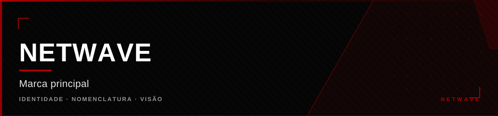

   

## O que é

A Netwave é a **marca principal** — a raiz que dá nome, nomenclatura e
identidade a todos os projetos abaixo.

Ela não é mais uma aplicação. Cada componente tem código, arquitetura,
tecnologias, finalidade e ciclo de desenvolvimento próprios. O que os reúne é
a mesma visão: **infraestrutura e software**, com gaming como uma das linhas
de trabalho.

> A Netwave é responsável pelo desenvolvimento e integração de plataformas de
> controle, clients de performance, sistemas de proteção e engines
> proprietárias — todas operando sob uma identidade central: o **Netwave ID**.

---

## Projetos

<table>
<tr>
<td width="50%" valign="top">

### <a href="https://github.com/hiro0010/axiom">Axiom</a>

<b>Plataforma de controle desktop.</b> Núcleo com módulos instaláveis: otimização
de sistema, comunicação social e customização do Discord.

Electron · React · TypeScript

 

### <a href="https://netwave.cloud">Site Netwave</a>

<b>Vitrine oficial.</b> Projetos, store, status e área de conta. Autenticação
real pelo Netwave ID.

HTML · CSS · JS · nginx · Docker

 

### <a href="https://github.com/hiro0010/vitalis">Vitalis</a>

<b>Plataforma de resiliência digital.</b> O sistema imunológico da
infraestrutura: mapeia dependências, detecta impacto e contém falhas.

Detecção de falhas · Fallback · Operação contínua

</td>
<td width="50%" valign="top">

### <a href="https://github.com/hiro0010/netwaveos">NetwaveOS</a>

<b>Sistema operacional Linux próprio.</b> Distribuição sobre a base CachyOS, com
Hyprland, dashboard Quickshell e a Yuna embarcada.

archiso · Hyprland · Quickshell · Calamares

 

### <a href="https://github.com/hiro0010/axionengine">AxionEngine</a>

<b>Motor nativo.</b> Telemetria e otimização de hardware em C++20, exposto como
addon N-API para o Axiom.

C++20 · CMake · N-API · WinAPI

 

### <a href="https://github.com/hiro0010/mochi-ac">Mochi-AC</a>

<b>Anti-cheat de servidor.</b> Detecção por simulação de movimento e combate,
para rede mista pirata + premium.

Java · Paper · PacketEvents

 

### <a href="https://github.com/hiro0010/nyx-client">NYX Client</a>

<b>Mod de PvP e performance.</b> 38 módulos com ClickGUI, HUD e humanização de
input.

Java 21 · Fabric 1.21.1 · Gradle

 

### <a href="https://github.com/hiro0010/axiom-bot">Axiom Bot</a>

<b>Bot de Discord.</b> 64 comandos com RBAC por cargo e modlogs.

Node · TypeScript · discord.js v14

</td>
</tr>
</table>

---

## Netwave ID

A identidade central que atravessa tudo: mesmo login no site, no painel Axiom
e nos servidores Minecraft. Entitlements (permissões compradas) viajam com a
conta, com expiração quando o plano é temporário e sem expiração quando é
vitalício.

---

## Valores

- **Transparência sobre o estado real** — se o checkout não está integrado, o
  site avisa; se a API de status falha, o site diz que não conseguiu confirmar
- **Código próprio onde importa** — anti-cheat, motor nativo e sistema
  operacional são desenvolvidos, não apenas consumidos
- **Sem promessas decorativas** — nada de número sem lastro

Parte da <a href="https://github.com/hiro0010/netwave">Netwave</a>
&middot; Owner: <a href="https://github.com/hiro0010">Hiro</a>

